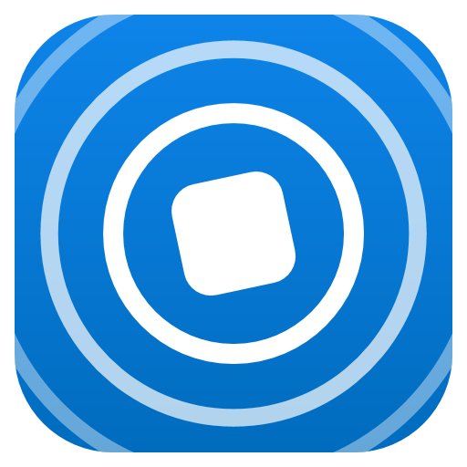
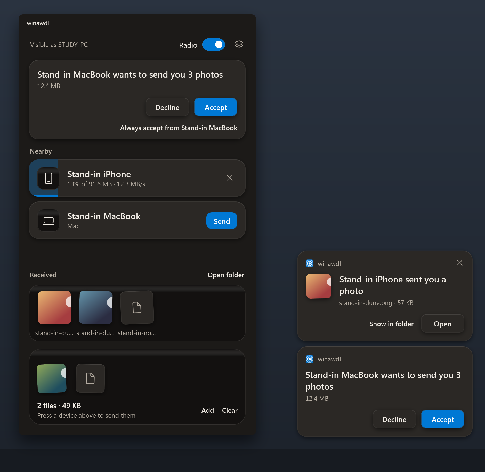

# winawdl

[](https://github.com/raph559/winawdl/actions/workflows/checks.yml)
[](https://github.com/raph559/winawdl/releases)
[](#licensing)

Apple's AWDL radio protocol and AirDrop, receiving and sending, running
natively on Windows, on the built-in Realtek RTL8852CE, with no USB adapter
and no Linux VM.



The devices and files in the picture are stand-ins from the app's own checks.

This is research code. Read [DESIGN-NOTES.md](DESIGN-NOTES.md) for the
design, the measurements, the open risks and the safety notes before
installing anything.

## Where it stands

| Part | State |
|---|---|
| Radio | The card receives and transmits Wi-Fi frames in monitor mode from an ordinary Windows program |
| AWDL | The daemon joins the AWDL channel, finds nearby Apple devices, synchronises with them and carries IPv6 traffic to and from them |
| Receiving | Photos, a 28 MB video and a Live Photo have arrived from an iPhone, at about 16 MB/s |
| Sending | Files have gone into the iPhone's Photos at 9 to 14 MB/s |
| The app | One window over both. Through it the radio has been started and stopped, a small file sent to the iPhone and one received from it. Large transfers through it have not been tried |
| The installer | Signs the driver on the PC it runs on, binds the card, and undoes both. It has run in full on the PC it was made on, and on no other |
| Not there | Contacts Only, in either direction. Any card but the RTL8852CE |

All of it has run on one machine, with one card, against one iPhone.

## Before you run it

- Installing the driver takes the Wi-Fi card away from Windows. Wi-Fi is down
  until you uninstall.
- The driver is signed with a certificate made on your machine, which is then
  added to the machine's trusted roots and trusted publishers. The installer
  deletes that certificate's private key as soon as the driver is signed, so
  nothing else can be signed with it. The scripts for a build from source
  keep the key, in a form that cannot be copied off the machine, to sign the
  next build.
- While the AirDrop receiver runs, any Apple device in range that is set to
  send to everyone can put files into your `Downloads` folder without being
  asked. The receiver opens nothing it stores. The app asks you first, unless
  its settings are changed to take everything.
- The card answers frames without waiting for Bluetooth, which shares its
  radio. Bluetooth devices may lose an occasional packet meanwhile.
- While the sender looks for a receiver it advertises over Bluetooth as an
  Apple device does before an AirDrop. Apple devices in range that are
  visible to everyone turn AWDL on for it.
- This is an independent project, not affiliated with or endorsed by Apple.
  AirDrop is a trademark of Apple Inc.

## What you need

- A PC whose Wi-Fi card is the Realtek RTL8852CE (PCI ID `10ec:c852`), on
  64-bit Windows 11. It has been tried on build 26200 only.
- Another way onto the network, such as a cable, for as long as the driver is
  installed.
- Bluetooth, to send: it is what wakes the receiver.
- An iPhone, iPad or Mac with AirDrop set to "Everyone for 10 Minutes".
- For the installer: the .NET Desktop Runtime 10, Python 3.10 or newer, and
  the Visual C++ runtime. It offers to fetch what is missing with `winget`.
- For a build from source: Visual Studio Build Tools 2022 with its bundled
  vcpkg, CMake, the Windows SDK, the Windows Driver Kit 10.0.26100, MinGW-w64
  GCC (the build script expects the one in `C:\Strawberry\c\bin`), the .NET
  SDK 10, Python 3.10 or newer, and Git for Windows.

## Install

### With the installer

1. Download `winawdl-<version>-windows-x64.zip` from
   [the releases](https://github.com/raph559/winawdl/releases) and unpack it
   anywhere.
2. Double-click `install.cmd`. Windows asks for administrator rights, then the
   installer lists what it will change and waits for your answer.
3. Start winawdl from the Start Menu and turn its Radio switch on. Windows
   asks for administrator rights again, for the radio.

The installer stops, having changed nothing, on a PC without the card. It
copies winawdl to `C:\Program Files\winawdl`, signs the driver there as
described under [Before you run it](#before-you-run-it), gives the card to
it, lets AirDrop through Windows Firewall from link-local addresses only, and
adds a Start Menu entry. `install.ps1 -DryRun` says all that and does none of
it.

To take it off again, use Uninstall on winawdl in the Start Menu or under
"Installed apps" in Settings, or `uninstall.cmd` in that folder. The app is
closed first if it is running. The card goes back to its own driver, the
certificate stops being trusted, and the rules and the files go. Files you
received stay.

No signature other than one made on your own PC is available to this
project, which is why the driver is signed there and not before. The
installer has so far run on one PC, the one it was made on. Its uninstaller
has not yet been run for real.

The radio also needs the right to lock pages in memory, which an elevated
prompt had from the start on that PC. The installer says so when it is
missing: give your account "Lock pages in memory" under Local Security
Policy, User Rights Assignment, and sign in again.

### From source

1. Get the source. GitHub's source archives leave the submodules out, so
   clone. A recursive clone would also pull devourer's vendor reference
   trees, which nothing here builds.

   ```powershell
   git clone https://github.com/raph559/winawdl.git
   cd winawdl
   git submodule update --init
   git -C upstream/owl submodule update --init radiotap
   ```

2. Fetch [Wintun](https://www.wintun.net/), WireGuard's virtual network
   adapter, which the AWDL daemon hands traffic to Windows through. The
   script downloads version 0.14.1 and checks its published hash and
   signature. Without it the daemon still runs but drops AWDL data.

   ```powershell
   .\scripts\fetch-wintun.ps1
   ```

3. Build. All five only compile.

   ```powershell
   .\driver\regproxy\build.ps1   # the driver
   .\tools\build.ps1             # driver test clients and probes
   .\scripts\build-radio.ps1     # devourer, its demos, and radio\
   .\scripts\build-awdl.ps1      # the AWDL daemon
   .\scripts\build-app.ps1       # the app
   ```

4. See that an elevated prompt can lock memory, which the radio needs for
   its DMA buffers. From an elevated prompt, `whoami /priv` lists
   `SeLockMemoryPrivilege` if it can, and `tools\build\awe_probe.exe` says how
   many 2 MiB blocks it gets. On the machine this has run on, it could from
   the start. Where it cannot, "Lock pages in memory" under Local Security
   Policy, User Rights Assignment, is the right to give your account, and it
   takes effect at the next sign-in.

5. Package and install the driver. From here on Wi-Fi is down.

   ```powershell
   .\scripts\package-driver.ps1     # build, stage and sign; no elevation
   .\scripts\install-driver.ps1     # elevated: trust the certificate, bind the card
   ```

6. Let AirDrop through Windows Firewall, once: two inbound rules, for
   link-local addresses only.

   ```powershell
   .\scripts\airdrop-firewall.ps1   # elevated
   ```

7. Start the app and turn its Radio switch on. Windows asks for
   administrator rights for the radio. The first run also installs Wintun's
   kernel driver, which is signed by WireGuard LLC.

   ```powershell
   .\build\app\winawdl\winawdl.exe
   ```

To undo it all:

```powershell
.\scripts\uninstall-driver.ps1        # elevated: back to the vendor driver, trust removed
.\scripts\airdrop-firewall.ps1 -Remove
```

`uninstall-driver.ps1 -RemoveSigningKey` also deletes the signing key.

## Using it

### The app

The app, from the Start Menu or as `build\app\winawdl\winawdl.exe`, needs
the driver bound, the two daemons and the firewall rules, and no elevated
prompt of its own.

- **Radio.** The switch starts the radio daemon and the AWDL daemon as
  `awdl-run.ps1` does with no arguments. Windows asks for administrator
  rights for a second copy of the app, which runs the two without a window
  and stops them when the switch goes off or the app ends. What they print
  goes to `C:\ProgramData\winawdl\logs`. A radio started from a terminal is
  used as it is.
- **Sending.** Devices show up while the window is open, which is also the
  only time it advertises over Bluetooth. Drop files on the window and press
  a device, or drop them on the device.
- **Receiving.** A device that wants to send is shown with what it offers,
  to accept or decline. Received files appear at the bottom of the window.
  While the window is not the one in front, the request shows as a card in
  the corner of the screen, with the same two choices, and so does what has
  arrived: pressing that card opens the file. Its settings turn the cards
  off. The icon in the notification area says under the pointer how far a
  transfer has got.
- **Always accepting a device.** A request also offers to accept everything
  from its device from then on, and the settings list those devices. A device
  is known only by the name and model it gives for itself, which is all
  AirDrop tells a PC that is not among its contacts: another device nearby
  giving the same two would be accepted too. What it sends is stored and
  never opened.
- **A device that stays away.** When the window says that a device nearby
  only answers devices it knows, set that device's AirDrop to "Everyone for
  10 Minutes".
- **Closing** the window leaves the app in the notification area, still
  receiving, until it is quit from its icon there. Its settings turn that off.

Over the air it has so far started and stopped the radio, sent one 0.2 MB
file to an iPhone and received one 71 kB picture from it. Large transfers
through it have not been tried, nor what a phone shows when a request from
it is declined. [app/DESIGN.md](app/DESIGN.md) is the direction its look
follows.

### From a terminal

Everything below needs an elevated prompt and the driver bound to the card.

```powershell
.\scripts\rx-test.ps1 -Channel 6              # monitor-mode receive, Ctrl+C to stop
.\scripts\tx-test.ps1 -Channel 6              # 500 broadcast test frames
.\build\radio\Release\awdl_sniff.exe 6 40     # list AWDL devices heard for 40 s
.\scripts\awdl-run.ps1                        # radio daemon plus AWDL daemon, channel 44
```

While `awdl-run.ps1` runs with Wintun present, Windows has a network adapter
named `awdl0`. The daemon prints the address of each peer it finds, which can
be pinged from another elevated or ordinary prompt.

To receive files over AirDrop, keep `awdl-run.ps1` running and then:

```powershell
.\scripts\airdrop-receive.ps1    # no elevation; Ctrl+C to stop
```

Five things make up most of that speed, and each has a switch on
`awdl-run.ps1` to turn it off: `-NoBlockAck` (the sender may no longer
aggregate its frames; one sender is served that way at a time), `-Width 40`
or `-Width 20` (the card listens on a narrower channel than 80 MHz, and the
faster VHT rates are no longer announced), `-Streams 1` and `-LongGuard`
(slower rates are announced), and `-Join 0` (Windows gets each TCP segment
as it comes, and acknowledges every second one).

For a recording or a shared screen, start them as `awdl-run.ps1 -Redact` and
`airdrop-receive.ps1 --redact`. The logs then number devices instead of
printing their addresses, and leave out the names of peers and senders, the
computer's name and the account's folder. File names still appear, and so
does the name senders see, which `--name` sets.

The receiver accepts files from everyone in range, as described under
[Before you run it](#before-you-run-it), and marks each one as downloaded from
the Internet.

To send, set the iPhone's AirDrop to "Everyone for 10 Minutes", keep it
unlocked, and with `awdl-run.ps1` running:

```powershell
.\scripts\airdrop-send.ps1 photo.jpg clip.mp4   # add --to "part of a name" if several answer
```

It needs the computer's Bluetooth to wake the receiver, and the firewall
rules. A 144.5 MB video went at 14.5 MB/s and a 24.5 MB one at 9 to
12 MB/s. Three things make up that speed, each with a switch on
`awdl-run.ps1`: the rate of outgoing data frames follows what the receiver
acknowledges (`-DataRate` fixes it), the receiver is asked to take those
frames in aggregates (`-NoAggregate`), and the card is handed frames fast
enough to fill them (`-NoQuickSubmit`). Contacts Only is not implemented in
either direction.

## How it fits together

| Piece | What it does |
|---|---|
| `driver/regproxy` | User-mode (UMDF 2) driver bound to the card. Relays register accesses and stops the chip's DMA if its client dies |
| `upstream/devourer` | Submodule: a fork of [devourer](https://github.com/OpenIPC/devourer), the user-space Realtek driver that runs the chip, with a Windows PCIe backend on its `winawdl/pcie-windows` branch |
| `radio` | Programs built on that devourer, including the radio daemon `winawdl_radio` |
| `upstream/owl` | Submodule: [OWL](https://github.com/seemoo-lab/owl), unmodified |
| `awdl` | The AWDL daemon `awdld`: OWL's protocol core with a Windows I/O layer |
| `airdrop` | The AirDrop receiver, adapted from [omdrop](https://github.com/brentkearney/omdrop-plugin): service announcement and the HTTPS endpoints senders talk to. A sender, which finds receivers and uploads to one. And the engine that runs both for the app |
| `app` | The Windows app: a window over the receiver and the sender, which also starts and stops the two daemons |
| `installer` | What installs a built copy on a PC and takes it off again: the scripts that go in a release's zip, which `scripts\build-installer.ps1` puts together |
| `tools`, `probes` | Small clients of the driver and one-off measurements |
| `scripts` | Build, packaging, install and test helpers |
| `deps` | Pinned vcpkg manifest for devourer's dependencies, and Wintun once fetched |
| `docs` | The pictures on this page |

## Testing without a radio

Most of the project can be checked with no hardware at all.
[The checks on GitHub](https://github.com/raph559/winawdl/actions/workflows/checks.yml)
run the Python tests, and the app's checks without its window, on every
push.

```powershell
py -m unittest discover -s airdrop\tests   # the receiver, the sender and the engine, over loopback
.\scripts\build-app.ps1 -Check             # the app: its checks, then its real window off screen
.\awdl\tests\fake-radio.ps1                # the AWDL daemon against a stand-in radio
```

The AirDrop layer is Python 3.10 or newer with no packages to install. Run
from a terminal, it needs OpenSSL once, to create its certificate, and finds
the one in Git for Windows by itself; the app makes that certificate for it.
`build-app.ps1 -Check` runs the app's real window, kept off
screen, against the receiver and sender over loopback, with a second copy of
them playing the other device, and presses every control through the
interface a screen reader uses. It leaves a log and a picture of each step
in `build\app\drive`. `radio` and `awdl` build their own test programs beside
the daemons.

C and C++ sources follow the `.clang-format` files, and the Python is checked
with `ruff check airdrop` against `airdrop\ruff.toml`.

## Taking part

[CONTRIBUTING.md](CONTRIBUTING.md) says how changes are made and checked
here, and [SECURITY.md](SECURITY.md) how to report a flaw without publishing
it. [CHANGELOG.md](CHANGELOG.md) lists what each tagged state holds.

## Licensing

Everything is MIT-licensed ([LICENSE](LICENSE)) except two folders that
build on copyleft projects:

- `radio` links devourer and is GPL-2.0-only ([radio/LICENSE](radio/LICENSE)).
  `radio/radio_link.h`, the protocol between the two daemons, is MIT so that
  both sides may include it.
- `awdl` builds on OWL and is GPL-3.0-or-later ([awdl/LICENSE](awdl/LICENSE)).

The two run as separate processes, and so does everything MIT beside them.
`airdrop` is adapted from omdrop and carries omdrop's own MIT notice in
`airdrop/LICENSE`. Wintun's prebuilt DLL comes under its own license, copied
next to it by the fetch script; it is loaded at run time and is not part of
this repository. The submodules keep their own licenses: devourer GPL-2.0,
OWL GPL-3.0.

## Built on

- [devourer](https://github.com/OpenIPC/devourer), from OpenIPC: the
  user-space driver for the chip.
- [OWL](https://github.com/seemoo-lab/owl) and the Open Wireless Link
  project's work on AWDL and AirDrop, from the Secure Mobile Networking Lab
  at TU Darmstadt.
- [omdrop](https://github.com/brentkearney/omdrop-plugin), by Brent Kearney:
  the receiver this one is adapted from.
- [Wintun](https://www.wintun.net/), from the WireGuard project.
