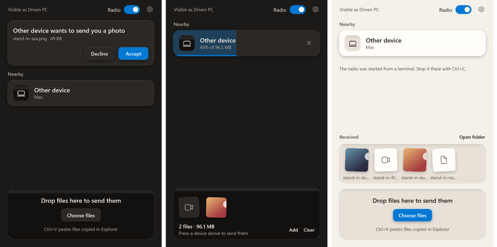

# winawdl

Apple's AWDL radio protocol and AirDrop, receiving and sending, running
natively on Windows, on the built-in Realtek RTL8852CE, with no USB adapter
and no Linux VM.

This is research code. The radio works: the card receives and transmits Wi-Fi
frames in monitor mode from an ordinary Windows program. On top of it the AWDL
daemon joins the AWDL channel, finds nearby Apple devices, synchronises with
them and carries IPv6 traffic to and from them. An AirDrop receiver on top of
that has received photos, a 28 MB video and a Live Photo from an iPhone, at
about 16 MB/s, and a sender has put files into the iPhone's Photos at 9 to
14 MB/s. All of it has run on one machine with one card. A Windows app puts
the two behind one window: through it the radio has been started and
stopped, a small file sent to the iPhone and one received from it. Read
[DESIGN-NOTES.md](DESIGN-NOTES.md) for the design, the
measurements, the open risks and the safety notes before installing anything.

## Before you run it

- Installing the driver takes the Wi-Fi card away from Windows. Wi-Fi is down
  until you run `scripts\uninstall-driver.ps1`.
- The package script signs the driver with a certificate it creates on your
  machine, and the install script adds that certificate to the machine's
  trusted stores.
- While the AirDrop receiver runs, any Apple device in range that is set to
  send to everyone can put files into your `Downloads` folder without being
  asked. The receiver opens nothing it stores. The app asks you first, unless
  its settings are changed to take everything.
- The card answers frames without waiting for Bluetooth, which shares its
  radio. Bluetooth devices may lose an occasional packet meanwhile.
- While the sender looks for a receiver it advertises over Bluetooth as an
  Apple device does before an AirDrop. Apple devices in range that are
  visible to everyone turn AWDL on for it.
- This is an independent project, not affiliated with or endorsed by Apple.
  AirDrop is a trademark of Apple Inc.

## How it fits together

| Piece | What it does |
|---|---|
| `driver/regproxy` | User-mode (UMDF 2) driver bound to the card. Relays register accesses and stops the chip's DMA if its client dies |
| `upstream/devourer` | Submodule: a fork of [devourer](https://github.com/OpenIPC/devourer), the user-space Realtek driver that runs the chip, with a Windows PCIe backend on its `winawdl/pcie-windows` branch |
| `radio` | Programs built on that devourer, including the radio daemon `winawdl_radio` |
| `upstream/owl` | Submodule: [OWL](https://github.com/seemoo-lab/owl), unmodified |
| `awdl` | The AWDL daemon `awdld`: OWL's protocol core with a Windows I/O layer |
| `airdrop` | The AirDrop receiver, adapted from [omdrop](https://github.com/brentkearney/omdrop-plugin): service announcement and the HTTPS endpoints senders talk to. And a sender, which finds receivers and uploads to one |
| `app` | The Windows app: a window over the receiver and the sender, which also starts and stops the two daemons |
| `tools`, `probes` | Small clients of the driver and one-off measurements |
| `scripts` | Build, packaging, install and test helpers |
| `deps` | Pinned vcpkg manifest for devourer's dependencies, and Wintun once fetched |

## Building

Clone, then fetch the two submodules and OWL's radiotap. A recursive clone
would also pull devourer's vendor reference trees, which nothing here builds.

```powershell
git clone https://github.com/raph559/winawdl.git
cd winawdl
git submodule update --init
git -C upstream/owl submodule update --init radiotap
```

Requires Visual Studio Build Tools 2022 with its bundled vcpkg, CMake, the
Windows SDK, the Windows Driver Kit 10.0.26100, and MinGW-w64 GCC for the AWDL
daemon (the build script expects the one in `C:\Strawberry\c\bin`).

```powershell
.\driver\regproxy\build.ps1   # the driver
.\tools\build.ps1             # driver test clients and probes
.\scripts\build-radio.ps1     # devourer, its demos, and radio\
.\scripts\build-awdl.ps1      # the AWDL daemon
```

All four only compile. `awdl\tests\fake-radio.ps1` then exercises the AWDL
daemon against a stand-in radio, with no hardware.

The AirDrop receiver and sender are Python 3.10 or newer with no packages to
install. They need OpenSSL once, to create their certificate, and find the
one in Git for Windows by themselves. Their tests run without hardware:

```powershell
py -m unittest discover -s airdrop\tests
```

C and C++ sources follow the `.clang-format` files, and the Python is checked
with `ruff check airdrop` against `airdrop\ruff.toml`.

The app is C# on WPF and needs the .NET SDK 10 or newer, and nothing else:

```powershell
.\scripts\build-app.ps1          # build\app\winawdl\winawdl.exe
.\scripts\build-app.ps1 -Check   # and its checks, which need no radio
```

`-Check` runs the app's real window, kept off screen, against the receiver
and sender over loopback, with a second copy of them playing the other
device, and presses every control through the interface a screen reader
uses. It leaves a log and a picture of each step in `build\app\drive`.

The AWDL daemon hands traffic to Windows through
[Wintun](https://www.wintun.net/), WireGuard's virtual network adapter.
`scripts\fetch-wintun.ps1` downloads version 0.14.1, checks its published hash
and signature, and leaves `wintun.dll` in `deps\wintun`. Without it the daemon
still runs but drops AWDL data.

## Installing the driver

```powershell
.\scripts\package-driver.ps1     # build, stage and sign; no elevation
.\scripts\install-driver.ps1     # elevated: trust the certificate, bind the card
.\scripts\uninstall-driver.ps1   # elevated: back to the vendor driver
```

[Before you run it](#before-you-run-it) says what installing changes on the
machine.

## Running

Everything below needs an elevated prompt and the driver bound to the card.

```powershell
.\scripts\rx-test.ps1 -Channel 6              # monitor-mode receive, Ctrl+C to stop
.\scripts\tx-test.ps1 -Channel 6              # 500 broadcast test frames
.\build\radio\Release\awdl_sniff.exe 6 40     # list AWDL devices heard for 40 s
.\scripts\awdl-run.ps1                        # radio daemon plus AWDL daemon, channel 44
```

While `awdl-run.ps1` runs with Wintun present, Windows has a network adapter
named `awdl0`. The daemon prints the address of each peer it finds, which can
be pinged from another elevated or ordinary prompt. The first run installs
Wintun's kernel driver, which is signed by WireGuard LLC.

To receive files over AirDrop, keep `awdl-run.ps1` running and then:

```powershell
.\scripts\airdrop-firewall.ps1   # elevated, once: two inbound rules, link-local only
.\scripts\airdrop-receive.ps1    # no elevation; Ctrl+C to stop
```

Five things make up most of that speed, and each has a switch on
`awdl-run.ps1` to turn it off: `-NoBlockAck` (the sender may no longer
aggregate its frames; one sender is served that way at a time), `-Width 40`
or `-Width 20` (the card listens on a narrower channel than 80 MHz, and the
faster VHT rates are no longer announced), `-Streams 1` and `-LongGuard`
(slower rates are announced), and `-Join 0` (Windows gets each TCP segment
as it comes, and acknowledges every second one).

For a recording or a shared screen, start them as `awdl-run.ps1 -Redact` and
`airdrop-receive.ps1 --redact`. The logs then number devices instead of
printing their addresses, and leave out the names of peers and senders, the
computer's name and the account's folder. File names still appear, and so
does the name senders see, which `--name` sets.

The receiver accepts files from everyone in range, as described under
[Before you run it](#before-you-run-it), and marks each one as downloaded from
the Internet. `.\scripts\airdrop-firewall.ps1 -Remove` deletes the rules.

To send, set the iPhone's AirDrop to "Everyone for 10 Minutes", keep it
unlocked, and with `awdl-run.ps1` running:

```powershell
.\scripts\airdrop-send.ps1 photo.jpg clip.mp4   # add --to "part of a name" if several answer
```

It needs the computer's Bluetooth to wake the receiver, and the firewall
rules above. A 144.5 MB video went at 14.5 MB/s and a 24.5 MB one at 9 to
12 MB/s. Three things make up that speed, each with a switch on
`awdl-run.ps1`: the rate of outgoing data
frames follows what the receiver acknowledges (`-DataRate` fixes it), the
receiver is asked to take those frames in aggregates (`-NoAggregate`), and
the card is handed frames fast enough to fill them (`-NoQuickSubmit`).
Contacts Only is not implemented in either direction.

### The app

`build\app\winawdl\winawdl.exe` does what the three scripts above do. It
needs the driver bound, both daemons built and the firewall rules, and no
elevated prompt of its own.



The devices and files in the picture are stand-ins from the app's own checks.

- **Radio.** The switch starts the radio daemon and the AWDL daemon as
  `awdl-run.ps1` does with no arguments. Windows asks for administrator
  rights for a second copy of the app, which runs the two without a window
  and stops them when the switch goes off or the app ends. What they print
  goes to `build\app\logs`. A radio started from a terminal is used as it is.
- **Sending.** Devices show up while the window is open, which is also the
  only time it advertises over Bluetooth. Drop files on the window and press
  a device, or drop them on the device.
- **Receiving.** A device that wants to send is shown with what it offers,
  to accept or decline. Received files appear at the bottom of the window.
- **Closing** the window leaves the app in the notification area, still
  receiving, until it is quit from its icon there. Its settings turn that off.

Over the air it has so far started and stopped the radio, sent one 0.2 MB
file to an iPhone and received one 71 kB picture from it. Large transfers
through it have not been tried, nor what a phone shows when a request from
it is declined. `build-app.ps1 -Check` covers the rest without a radio.
[app/DESIGN.md](app/DESIGN.md) is the direction its look follows.

## Licensing

Everything is MIT-licensed ([LICENSE](LICENSE)) except two folders that
build on copyleft projects:

- `radio` links devourer and is GPL-2.0-only. `radio/radio_link.h`, the
  protocol between the two daemons, is MIT so that both sides may include it.
- `awdl` builds on OWL and is GPL-3.0-or-later.

`airdrop` is adapted from omdrop and carries omdrop's own MIT notice in
`airdrop/LICENSE`. Wintun's prebuilt DLL comes under its own license, copied
next to it by the fetch script; it is loaded at run time and is not part of
this repository. The submodules keep their own licenses: devourer GPL-2.0,
OWL GPL-3.0.
